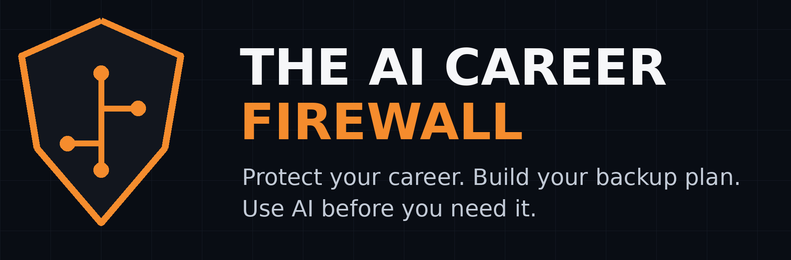

# The AI Career Firewall: Prompt Library

Every prompt from my videos, ready to copy. Tap the copy icon on any box, paste it into ChatGPT, Claude or Gemini (free versions work), and add your own details.

New prompts are added here every time a video goes out. Newest first.

**📘 [Get the free RIF Readiness Kit →](https://drive.google.com/file/d/1TXv3vlVcr1BoRWBVU2b8I4YGDCIa6npR/view?usp=sharing)**

---

## 6. Answer "tell me about yourself" in 45 seconds

Paste your resume, then this:

```
Write a 45-second answer to 'tell me about yourself': my current role, one result with a number, and why this job. Plain words.
```

Why it works: one real number turns a vague intro into proof.

---

## 5. Negotiate a layoff package

Paste your severance letter (remove names and anything confidential), then this:

```
List every term I could negotiate, what to ask for, and draft a polite email asking for it.
```

Why it works: most people sign without asking about extra weeks of pay, health coverage, a prorated bonus, or a written reference. Not legal advice; check any agreement with HR or an employment lawyer.

---

## 4. Answer a last-minute "need this by tomorrow" request

Paste your boss's message, then this:

```
Write a short, friendly reply to this request. Confirm what's due and when, offer two scope options (a quick version by morning or a full version by end of day), and ask which matters most.
```

Why it works: your boss picks the scope, so you don't lose your night guessing.

---

## 3. Fix your weakest resume bullet

Paste one weak bullet from your resume, then this:

```
Rewrite this as one resume bullet that shows an outcome with a number. If you need a number I didn't give you, ask me for it. Don't make one up.
```

Why it works: it asks you for real numbers instead of inventing them. Real numbers are what get interviews.

---

## 2. Messy notes to a status report in 30 seconds

Paste your meeting notes, then this:

```
Turn these notes into a status report with 3 sections: Done, At Risk, Decisions Needed. Under 150 words. Flag anything with no owner or date.
```

Why it works: the "no owner" flags are the part your boss notices.

---

## 1. Find out which parts of your job AI can already do

Paste your job description (or a public posting for your role), then this:

```
Split every task in this job description into 3 columns: AI can do it today / AI makes it faster / Still needs a human. Put it in a table.
```

Why it works: column 1 is your risk. Column 3 goes at the top of your resume.

---

## Want this done for your exact job?

**The AI Career Firewall Audit: $39.** A 1-page layoff-readiness plan plus 5 AI prompts written for your role, back within 48 hours.

**[Get your audit →](https://buy.stripe.com/3cI00ldx57fS0IM7K108g00)**

Questions: theaicareerfirewall@gmail.com

<sub>The AI Career Firewall · by Montanez Solutions</sub>
